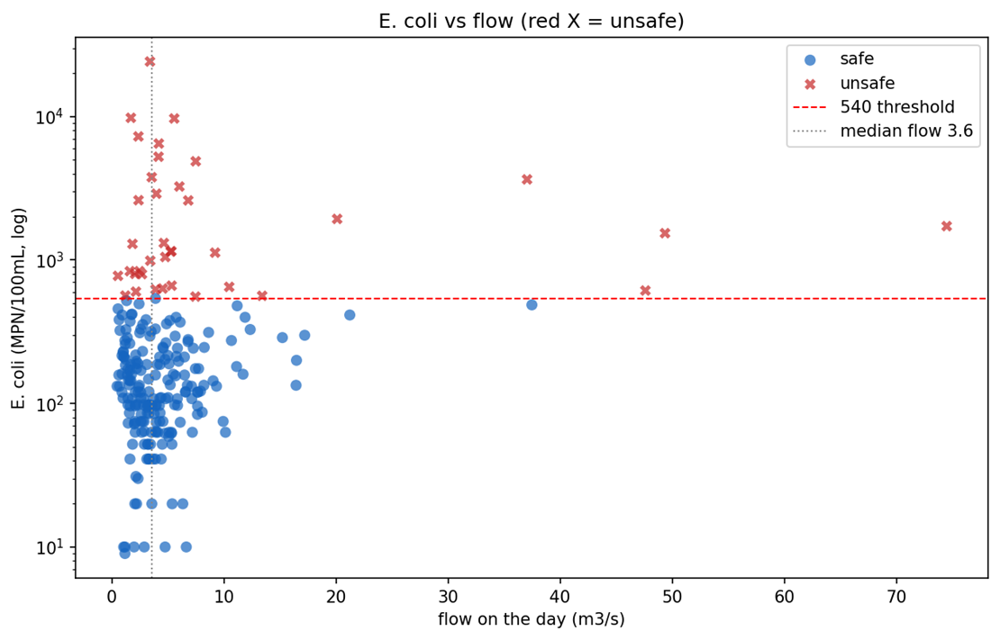

# Swim Safe Prediction: Oroua River at Almadale

**Predicting unsafe swimming days from river flow, rainfall and water temperature** | MINZ 2026



## Overview

Water quality samples for E. coli are taken only occasionally and take time to process in the lab, so swimmers often don't know whether a river is safe on the day they visit. This project builds a machine learning early-warning model that predicts whether E. coli at the **Oroua River at Almadale** swim spot is likely to exceed the safe swimming limit, using data that is available every day: river flow, rainfall at nearby gauges and water temperature.

The goal is a daily "safe / unsafe" flag that could feed a public swim-safety platform such as LAWA, so people can make better decisions before they get in the water.

## Problem definition

| Item | Detail |
|---|---|
| Location | Oroua River at Almadale (Manawatū-Whanganui, New Zealand) |
| Target | `unsafe = 1` when E. coli ≥ **540 CFU/100mL** (NZ Ministry of Health freshwater recreation guideline), else `0` |
| Labelled samples | 485 days with an E. coli result (July 2005 to April 2026) |
| Unsafe rate | 77 of 485 samples (about 16%), so the classes are imbalanced |
| Priority metric | **Recall on unsafe days**, because a missed unsafe day is a public health risk while a false alarm only costs a swim |

## Data

| Source | Variables |
|---|---|
| Flow at Almadale | Daily mean, max and min flow (m³/s) |
| Rainfall at 4 gauges | Rangiwahia, Cheltenham, Halcombe, Mangaone Valley: daily total and max hourly intensity |
| Water temperature at Almadale | Daily mean, max and min |
| E. coli labels | State of Environment (SoE) monitoring samples, with swim-spot samples as a fallback |

The raw data files are not included in this repository. The engineered feature table `features_labelled.csv` (485 rows, 61 columns) is included so the modelling notebooks can be run directly.

## Approach

### 1. Preprocessing and feature engineering (`preprocessing.ipynb`)
- Reshaped flow, rainfall and temperature series into one daily feature matrix
- **Lag features** at 1, 2 and 3 days, because contamination from run-off reaches the river after rain falls
- **Antecedent condition features**: number of heavy-rain days and high-flow days in the previous 7 days
- Attached E. coli labels and produced validation plots

### 2. Exploratory analysis (`eda.ipynb`)
- E. coli vs flow, rainfall and water temperature, with the 540 threshold marked
- Unsafe days cluster after rainfall events, and many occur at moderate flows, so flow alone is not enough to separate safe from unsafe days
- Missingness analysis of predictors and site maps of gauges and the swim spot

### 3. Baseline models (`baseline.ipynb`)
- Feature selection with a **VIF check** (features with VIF > 10 removed) to reduce multicollinearity
- Rainfall gaps imputed as zero; other gaps imputed with the median plus missingness indicators
- **Logistic regression** and **random forest**, evaluated with stratified 5-fold cross-validation
- Decision threshold tuned per fold to maximise **F2-score**, which weights recall above precision
- **Temporal hold-out**: trained on data before 2024, tested on 2024 onwards to mimic real-world use

### 4. Gradient boosting and decision rules (`gradient_boosting.ipynb`)
- Gradient boosted trees with grid search (most common best settings: 200 trees, learning rate 0.05, max depth 3, min samples per leaf 5)
- Threshold analysis showing the trade-off between unsafe days caught and false alarms
- A **rainfall gate**: flag a day as unsafe only if the model probability is ≥ 0.05 **and** Mangaone Valley rainfall was ≥ 0.5 mm/hr the previous day. This removes many false alarms while keeping recall high.

## Results

### Cross-validation (5-fold)

| Model | Unsafe recall | Precision | F2 | ROC-AUC | Balanced accuracy |
|---|---|---|---|---|---|
| Logistic regression | 0.71 ± 0.10 | 0.61 ± 0.12 | 0.68 | 0.83 | 0.81 |
| Random forest | 0.82 ± 0.13 | 0.49 ± 0.12 | 0.70 | 0.84 | 0.82 |
| Gradient boosting | 0.57 ± 0.12 | 0.48 ± 0.13 | 0.54 | 0.80 | 0.72 |

### Temporal hold-out (2024 onwards, 92 days, 11 unsafe)

| Model | Unsafe caught | False alarms | Recall | ROC-AUC |
|---|---|---|---|---|
| Logistic regression | 5 / 11 | n/a | 45% | 0.83 |
| Random forest | 7 / 11 | n/a | 64% | 0.81 |
| Gradient boosting (threshold 0.19) | 8 / 11 | 15 / 81 | 73% | 0.81 |
| Gradient boosting (threshold 0.05) | 10 / 11 | 40 / 81 | 91% | 0.81 |
| **Gradient boosting + Mangaone rain gate (final)** | **9 / 11** | **20 / 81** | **82%** | **0.81** |

The final model catches 82% of unsafe days while halving the false alarms of the low-threshold model, a better balance between public safety and unnecessary warnings.

### Top predictors (final model)
1. Halcombe total rainfall (27%)
2. Halcombe max hourly rainfall (19%)
3. Almadale mean flow, 2 days earlier (15%)
4. Almadale minimum flow, 3 days earlier (15%)

Recent rainfall in the catchment, and how the river responded over the previous few days, matter more than conditions on the day itself.

## Recommended deployment

- Run the model daily using automated rainfall and flow feeds
- Flag **UNSAFE** if model probability > 0.05 **and** Mangaone Valley rainfall ≥ 0.5 mm/hr the previous day
- Publish the flag to a swim-safety platform such as LAWA
- Retrain every year as new lab samples become available

## Limitations

- Small number of labelled days (485), with only 11 unsafe days in the hold-out period, so results carry uncertainty
- Samples are irregular and concentrated in the swimming season
- Other contamination sources (e.g. livestock access, wastewater discharges) are not captured directly by flow and rainfall

## Repository structure

```
├── preprocessing.ipynb       # build daily features, lags and labels
├── eda.ipynb                 # exploratory analysis
├── baseline.ipynb            # logistic regression and random forest
├── gradient_boosting.ipynb   # gradient boosting, thresholds and rain gate
├── features_labelled.csv     # engineered feature table (485 x 61)
├── image.png                 # E. coli vs flow plot
└── README.md
```

## How to run

1. Install the libraries:
   ```
   pip install pandas numpy scikit-learn xgboost statsmodels scipy matplotlib seaborn plotly folium
   ```
2. Open `eda.ipynb`, `baseline.ipynb` and `gradient_boosting.ipynb` in Jupyter. They read `features_labelled.csv` from the repo.
3. `preprocessing.ipynb` needs the raw flow, rainfall, temperature and E. coli files, which are not included.

## Tools

Python (pandas, NumPy, scikit-learn, XGBoost, statsmodels, SciPy), Matplotlib, Seaborn, Plotly, Folium, Jupyter

## Author

**Jannathul Firdouz**
Master of Analytics, Auckland University of Technology
GitHub: [jannathulfirdouz](https://github.com/jannathulfirdouz)
